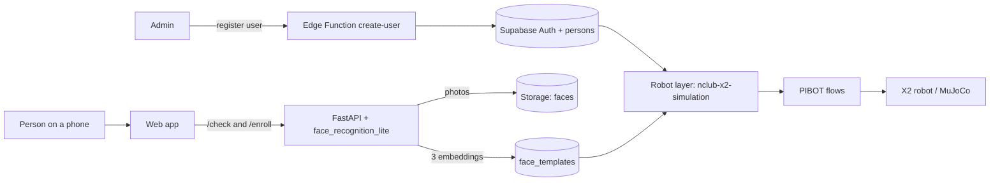

<h1 align="center">N Club</h1>

<p align="center">
  A face-registration and visitor-category prototype that feeds the N Club reception robot.
</p>

<p align="center">
  
  
  
  
  
</p>

N Club is a private members club whose entrance relies on staff. Its facial recognition only tells members from non-members, but five kinds of visitors arrive and each needs different guidance. This repository covers the first link of the answer: a mobile-first web app where an admin registers people with their category, and each person registers three face photos that are **validated before anything is saved**. The robot layer reads that data to recognize the visitor and confirm which of the five categories applies.

> This is an academic hackathon prototype built for the Sabana Hack N Club challenge (see [`N Club.md`](N%20Club.md)). Face photos and embeddings are biometric data. The system does not verify that a real person is present and must not be used for access control.

## Product experience

- Login with document and password, plus an **Admin** section to register users: first name, last name, document, password, role and place. It replaces creating each user by hand in Supabase.
- Guided capture of three photos: front, turn left, turn right. A small on-device face detector checks framing and head turn, and the photo is taken automatically when the pose holds.
- Instant feedback after each photo (no face, blurry, bad light, too far or close). If the three photos do not match each other, only the rejected poses are asked again.
- Nothing reaches the database until the three photos pass together.
- Mobile first, white and quiet: a single oval motif for the seal, the profile and the camera.

## Architecture



## Related repositories

This repo is one of four pieces. The three others were written by teammates.

| Repository | Role |
| --- | --- |
| [`FaceRecognition_lite`](https://github.com/FerminEscalona/FaceRecognition_lite) | Face engine: detection, embeddings and matching. Packaged as the `.whl` used here. |
| [`nclub-x2-simulation`](https://github.com/rafaelsava/nclub-x2-simulation) | Robot layer: MuJoCo simulation, voice, and the service that reads `persons` and `face_templates` to identify people. |
| [`PIBOT`](https://github.com/santiagoguti17/PIBOT) | Visual editor of reception flows: what the robot does for each category. |

## Technology

| Layer | Stack |
| --- | --- |
| Web app | HTML, CSS and vanilla JavaScript in one file, no build. Supabase JS v2, MediaPipe Face Detector 1.1.1 (both from CDN). Bodoni Moda and Hanken Grotesk. |
| Validation server | Python 3.11, FastAPI, uvicorn, supabase-py. |
| Face engine | `face_recognition_lite` 0.1.0: YuNet detector and SFace embeddings through OpenCV 4.12. 128 values, L2-normalized. |
| Data | Supabase Auth, Postgres with pgvector, private Storage bucket `faces`, row level security. |
| Serverless | Supabase Edge Function in Deno (`create-user`). |
| Demo access | Cloudflare quick tunnel, so a phone can reach the local server over HTTPS. |

## Data model

| Table | Fields |
| --- | --- |
| `persons` | `person_id`, `first_name`, `last_name`, `category`, `destination` |
| `face_templates` | `template_id`, `person_id`, `embedding vector(128)`, `model_version` |
| `admins` | `user_id` (accounts allowed to register users) |

`face_templates` holds exactly three rows per person, written only by the server. The photos live in Storage as `faces/<person_id>/front.jpg`, `left.jpg` and `right.jpg`.

| `category` | Visitor type |
| --- | --- |
| `member_vip` | VIP member |
| `member_regular` | Regular member |
| `guest` | Guest |
| `staff` | Club staff |
| `contractor` | External worker |

`destination` is free text. The robot layer uses these place names: Recepción, Salón VIP, Zona social, Terraza, Restaurante, Gimnasio, Spa, Acceso de servicio and Vestier de personal.

## Repository structure

```text
.
|-- index.html                         # Web app: login, admin, guided capture
|-- schema.sql                         # Tables, policies and the faces bucket
|-- backend/
|   |-- server.py                      # Serves the page; /check and /enroll
|   |-- enroll.py                      # Manual enrollment from photos in Storage
|   `-- README.md                      # Backend setup details
|-- supabase/functions/create-user/    # Edge Function that registers users
|-- face_recognition_lite-0.1.0-py3-none-any.whl
|-- N Club.md                          # Challenge brief
`-- CamposDB.jpeg, instrucciones.jpeg  # Agreed fields and backend instructions
```

## Run locally

Requirements: a Supabase project, Python 3.11, and [`cloudflared`](https://developers.cloudflare.com/cloudflare-one/connections/connect-apps/) to open the app on a phone.

```bash
git clone https://github.com/10santiago12/S2FRASabanaHack.git
cd S2FRASabanaHack
```

1. **Database.** Run `schema.sql` in the Supabase SQL editor.
2. **Admin account.** In Authentication, create `<user>@nclub.local` (auto confirm), then run `insert into admins (user_id) values ('<its uuid>');`.
3. **Edge Function.** Deploy `supabase/functions/create-user/index.ts` with the name `create-user`.
4. **Server.** Install and start it from the repository root (PowerShell):

```powershell
python -m venv .venv                      # Python 3.11
.\.venv\Scripts\python.exe -m pip install .\face_recognition_lite-0.1.0-py3-none-any.whl supabase fastapi uvicorn python-multipart
.\.venv\Scripts\face-lite.exe download-models    # needs internet, once

$env:SUPABASE_URL = "https://<project>.supabase.co"
$env:SUPABASE_SERVICE_ROLE_KEY = "<secret key>"
.\.venv\Scripts\python.exe backend\server.py
```

5. **Phone.** In a second terminal run `cloudflared tunnel --url http://localhost:8000` and open the `https://….trycloudflare.com` address it prints. On the computer, `http://localhost:8000` works without a tunnel.

Set the Supabase URL and public key at the top of the script in `index.html`. The secret key stays in the terminal only.

## What is real and what is simulated

| Part | Status |
| --- | --- |
| Registration, photo validation, embeddings, Supabase storage | Real, in this repo |
| Face recognition at the robot | Real, in `nclub-x2-simulation` |
| Robot movement | Real physics in MuJoCo; the physical X2 is pending |
| Robot voice, gestures and screen | Simulated, according to the robot repos |

## Engineering decisions

- **Validate before saving.** The server runs the same engine as the robot on the three photos together. If they fail, nothing is stored, so there is nothing to clean up.
- **Server-side user creation.** Creating accounts needs the secret key, which cannot live in a browser, so an Edge Function checks that the caller is an admin and does it.
- **Document as login.** Supabase Auth requires an email, so the document maps to `<document>@nclub.local`. The domain must match in `index.html` and in the Edge Function.
- **Same engine as the robot.** The server stores the engine's own `model_version`. The robot service only loads templates with that exact version, so both must run the same package, configuration and OpenCV version.
- **Light guidance, strict backend.** The browser detector only helps the person pose. The server decides whether the photos are accepted.
- **Photos kept, robot reads embeddings.** Storage keeps the photos; the robot reads only the embeddings.

## Limitations and responsible use

- Any signed-in account can read every `persons` and `face_templates` row, so the robot can sign in. That also exposes all embeddings to every registered person. A production system needs a dedicated read role.
- There is no liveness detection: a printed photo could pass.
- Accuracy is not validated for this setup. The face engine reports 85 to 90 % correct identification on the public ORL dataset against a 95 % goal, and the thresholds used by the robot are manual. Real phone and robot captures are still missing.
- Capture thresholds (face size and head turn) are provisional and live as constants at the top of the capture script.
- Cloudflare quick tunnels change address on every run and have no uptime guarantee.
- Login is basic: no password recovery, no rate limiting.
- Which source decides the category on the physical robot, Supabase or the club's membership list, is still to be agreed with the team.

## Team

Built by [rafaelsava](https://github.com/rafaelsava), [santiagoguti17](https://github.com/santiagoguti17), [FerminEscalona](https://github.com/FerminEscalona) and [10santiago12](https://github.com/10santiago12), one repository each. <!-- Add full names here, as in last year's README. -->

See [`N Club.md`](N%20Club.md) for the challenge brief and evaluation criteria.
